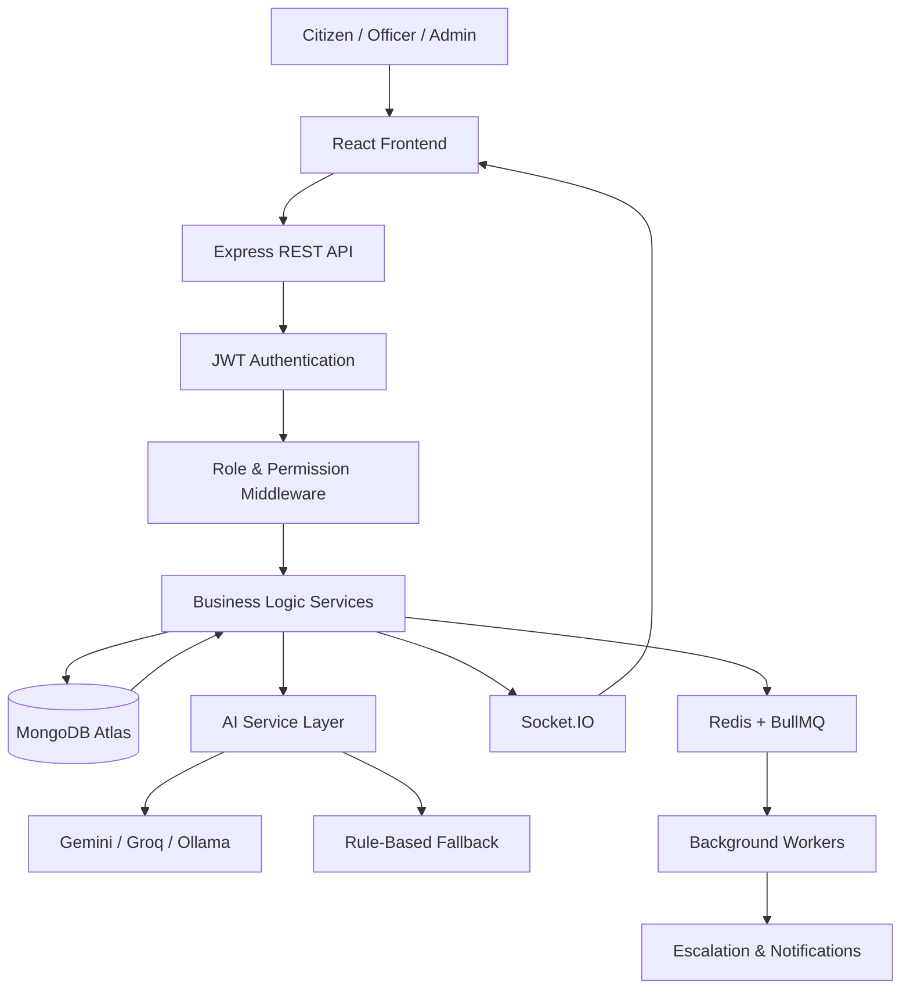
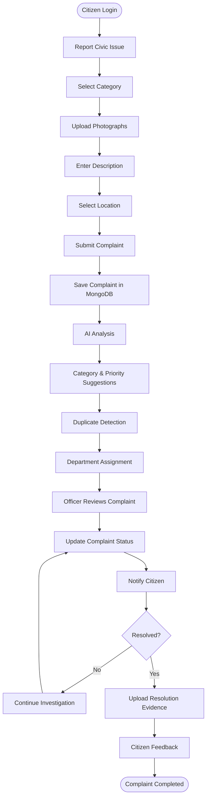
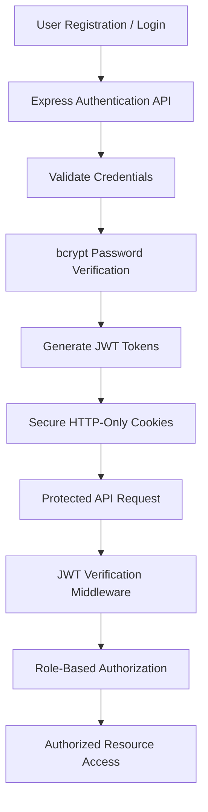

# PeopleFix — AI-Powered Public Grievance Management Platform 🚀

<p align="center">
  
</p>

<h3 align="center">Making Cities Better Through Technology and AI</h3>

<p align="center">
  <a href="https://peoplefix.ai.studio">🌐 Live Demo</a> •
  <a href="#features">Features</a> •
  <a href="#architecture">Architecture</a> •
  <a href="#installation">Installation</a>
</p>

---

## 🌍 Overview

**PeopleFix** is an AI-powered public grievance management platform that connects citizens, government department officers, and municipal administrators through a centralized digital system.

It addresses common civic problems such as road potholes, garbage accumulation, broken streetlights, water leakage, drainage issues, and public sanitation problems.

Citizens can report civic issues, upload photographs, provide geographical locations, and track complaint progress. Department officers can manage assigned complaints, while administrators monitor operations through analytics and centralized dashboards.

The platform integrates AI-assisted complaint classification, priority recommendations, duplicate detection, and historical complaint analysis to make grievance management smarter and more efficient.

🌐 **Live Application:** https://peoplefix.ai.studio

---

## 📸 Application Screenshots

Add your actual application screenshots inside `docs/screenshots/` using the filenames below.

### 1. Citizen Dashboard


*Overview of complaints, resolution progress, and citizen activity.*

### 2. Report a Civic Issue


*Multi-step complaint registration with category selection, photographs, description, and location.*

### 3. Live Issue Map


*Geographical visualization of reported civic issues.*

### 4. Complaint Tracking


*Complaint status, progress timeline, and resolution updates.*

### 5. Officer Dashboard


*Department-level complaint management and assignments.*

### 6. Admin Dashboard


*Administrative analytics, complaint statistics, and platform management.*

> Screenshots for pages that are not yet implemented should be added only after those pages are available.

---

## ✨ Features

### 👤 1. User Authentication & Authorization

- Custom authentication using Node.js, Express.js, MongoDB, and JWT.
- Secure user registration and login.
- Password hashing using bcrypt.
- JWT-based authentication.
- Access and refresh token management.
- Protected routes and session management.
- Role-Based Access Control (RBAC).
- Three user roles:
  - Citizen
  - Department Officer
  - Administrator

### 📝 2. Smart Complaint Registration

- Report civic problems through a structured form.
- Multiple complaint categories.
- Upload supporting photographs.
- Add detailed issue descriptions.
- Select geographical location.
- Generate unique complaint tracking IDs.
- Maintain complaint submission history.

### 🤖 3. AI-Powered Complaint Intelligence

- AI-assisted complaint classification.
- Automatic category and department suggestions.
- Priority recommendations based on severity.
- Image-based issue analysis when a vision-capable provider is configured.
- Duplicate complaint candidate detection.
- Similar historical complaint retrieval.
- Resolution recommendations.
- AI-generated administrative summaries.

### 🗺️ 4. Geospatial Issue Mapping

- Interactive maps using Leaflet and OpenStreetMap.
- Display reported civic issues geographically.
- Category-based markers.
- Location-based complaint filtering.
- Latitude and longitude support.
- Geographic complaint analysis.

### 📊 5. Complaint Tracking & Management

- Unique complaint IDs.
- Real-time complaint status updates.
- Complaint history and progress timeline.
- Officer assignment.
- Resolution evidence uploads.
- Citizen feedback and ratings.
- Complaint reopening workflow.

### 🚨 6. Automated Escalation

- Configurable complaint resolution deadlines.
- Overdue complaint detection.
- Priority-based escalation.
- Escalation to senior officers.
- Escalation history and notifications.
- Background processing using Redis and BullMQ.

### 🔔 7. Notifications

- Complaint submission notifications.
- Assignment notifications.
- Status update notifications.
- Resolution notifications.
- Escalation notifications.
- Notification history and unread count.
- Real-time updates using Socket.IO.

### 🏢 8. Role-Based Dashboards

**Citizen Dashboard**
- Submitted complaints.
- Pending and resolved issues.
- Complaint tracking.
- Notifications.
- Nearby civic issues.

**Officer Dashboard**
- Assigned complaints.
- Department-level issue management.
- Complaint status updates.
- Resolution evidence.
- Department performance metrics.

**Admin Dashboard**
- User management.
- Department management.
- Complaint assignment.
- Escalation management.
- Complaint analytics.
- Platform activity monitoring.

---

## 🏗️ Architecture

PeopleFix follows a modular full-stack architecture.



### Complaint Processing Workflow



### Authentication Workflow



---

## 🛠️ Technology Stack

| Layer | Technologies |
|---|---|
| Frontend | React.js, Vite, Tailwind CSS |
| Routing | React Router |
| API Communication | Axios |
| Backend | Node.js, Express.js |
| Database | MongoDB Atlas, Mongoose |
| Authentication | JWT, bcrypt |
| AI Integration | Gemini / Groq / Ollama (configurable) |
| Maps | Leaflet, OpenStreetMap |
| Charts | Recharts |
| Real-Time Communication | Socket.IO |
| Background Jobs | Redis, BullMQ |
| Deployment | Configurable cloud hosting |

---

## 🔐 Authentication & Security

PeopleFix uses a custom authentication architecture rather than third-party authentication services.

Security considerations:

- Password hashing with bcrypt.
- JWT access and refresh tokens.
- Secure HTTP-only cookies.
- Refresh token rotation and revocation.
- Protected API routes.
- Role-based authorization.
- Department-level access restrictions.
- Request validation.
- Rate limiting.
- Secure file upload validation.
- CORS configuration.
- Audit logging.

---

## 🗄️ Database Design

MongoDB is used for persistent data storage.

Core collections:

| Collection | Purpose |
|---|---|
| Users | Citizens, officers, and administrators |
| RefreshTokens | Secure refresh-token management |
| PasswordResetTokens | Password reset workflows |
| Departments | Department information |
| Complaints | Civic complaint records |
| ComplaintHistory | Complaint status history |
| Notifications | User notifications |
| Escalations | Escalation records |
| AuditLogs | Administrative activity |
| Feedback | Citizen ratings and feedback |

Geospatial indexing can be implemented using MongoDB's `2dsphere` indexes for location-based queries.

---

## 📂 Project Structure

```text
peoplefix/
│
├── client/
│   └── src/
│       ├── components/
│       ├── pages/
│       ├── layouts/
│       ├── hooks/
│       ├── services/
│       ├── context/
│       ├── routes/
│       └── utils/
│
├── server/
│   └── src/
│       ├── config/
│       ├── controllers/
│       ├── models/
│       ├── routes/
│       ├── middleware/
│       ├── services/
│       │   ├── auth/
│       │   ├── ai/
│       │   └── notifications/
│       ├── jobs/
│       ├── sockets/
│       ├── validators/
│       ├── utils/
│       ├── app.js
│       └── server.js
│
├── docs/
│   └── screenshots/
│
├── .env.example
├── .gitignore
├── README.md
└── docker-compose.yml
```

---

## ⚙️ Installation

### Prerequisites

Make sure you have:

- Node.js (LTS)
- npm
- MongoDB Atlas account or local MongoDB
- Redis instance (for background jobs)
- Git

### 1. Clone the Repository

```bash
git clone https://github.com/YOUR_USERNAME/peoplefix.git
cd peoplefix
```

Replace `YOUR_USERNAME/peoplefix` with your actual GitHub repository URL.

### 2. Install Dependencies

Frontend:

```bash
cd client
npm install
```

Backend:

```bash
cd ../server
npm install
```

### 3. Configure Environment Variables

Create a `.env` file inside the `server` directory.

```env
PORT=5000
NODE_ENV=development
CLIENT_URL=http://localhost:5173

MONGODB_URI=your_mongodb_connection_string

JWT_ACCESS_SECRET=your_access_secret
JWT_REFRESH_SECRET=your_refresh_secret

JWT_ACCESS_EXPIRES_IN=15m
JWT_REFRESH_EXPIRES_IN=7d

REDIS_URL=your_redis_connection_url

AI_PROVIDER=rule-based
AI_API_KEY=
GEMINI_MODEL=
GROQ_MODEL=

OLLAMA_BASE_URL=http://localhost:11434
OLLAMA_MODEL=

EMAIL_PROVIDER=
EMAIL_API_KEY=
EMAIL_FROM=

STORAGE_PROVIDER=local
```

**Important:**
- Replace placeholder values with your own configuration.
- Generate strong, unique JWT secrets.
- Configure Redis if background jobs are enabled.
- AI provider credentials are optional when using rule-based fallback.
- Never upload `.env` files or credentials to GitHub.

### 4. Start the Backend

```bash
cd server
npm run dev
```

### 5. Start the Frontend

Open another terminal:

```bash
cd client
npm run dev
```

Open:

```text
http://localhost:5173
```

---

## 🔌 API Overview

| Method | Endpoint | Description |
|---|---|---|
| POST | `/api/auth/register` | Register a user |
| POST | `/api/auth/login` | User login |
| POST | `/api/auth/refresh` | Refresh access token |
| POST | `/api/auth/logout` | Logout |
| GET | `/api/auth/me` | Get authenticated user |
| POST | `/api/complaints` | Create complaint |
| GET | `/api/complaints/my` | Get citizen complaints |
| GET | `/api/complaints/:id` | Get complaint details |
| PATCH | `/api/complaints/:id/reopen` | Reopen complaint |
| POST | `/api/ai/analyze-description` | Analyze complaint description |
| POST | `/api/ai/classify-image` | Classify uploaded image |
| GET | `/api/officer/complaints` | Get assigned complaints |
| PATCH | `/api/officer/complaints/:id/status` | Update complaint status |
| GET | `/api/admin/dashboard` | Admin dashboard data |
| GET | `/api/admin/analytics` | Platform analytics |
| GET | `/api/map/complaints` | Geographic complaint data |

See the backend route implementation for the complete API contract.

---

## 🧠 AI Integration

PeopleFix uses a provider-independent AI service architecture.

Supported provider options:

- Google Gemini
- Groq
- Ollama
- Rule-based fallback

AI capabilities include:

1. Complaint category recommendations.
2. Priority recommendations.
3. Description analysis.
4. Image-based issue classification.
5. Similar complaint detection.
6. Historical resolution suggestions.
7. Administrative report generation.

AI suggestions should be reviewed by authorized officers before consequential decisions are made.

---

## 🚀 Future Improvements

- Multilingual complaint registration.
- Voice-based complaint submission.
- SMS and WhatsApp notifications.
- Advanced geospatial heatmaps.
- Predictive civic maintenance analytics.
- Public transparency dashboard.
- More advanced image classification.
- Department performance benchmarking.
- Mobile application for field officers.

---

## 🎯 Problem Statement & Impact

Traditional public grievance systems often lack transparency, efficient tracking, and effective communication between citizens and government departments.

PeopleFix aims to improve this process by providing:

- Transparent complaint tracking.
- Centralized grievance management.
- Faster issue identification.
- Location-based complaint analysis.
- AI-assisted prioritization.
- Better coordination between departments.
- Data-driven administrative decisions.

---

## 👨‍💻 Author

**Ujjwal Awasthi**

- GitHub: [@ujjwalawasthi7597-del](https://github.com/ujjwalawasthi7597-del)
- LinkedIn: [Ujjwal Awasthi](https://www.linkedin.com/in/ujjwal-awasthi-90942237b)
- LeetCode: [Ujjwal9795](https://leetcode.com/u/Ujjwal9795/)
- GeeksforGeeks: [Profile](https://www.geeksforgeeks.org/profile/ujjwalawavs96/)

---

## 📄 License

This project is intended for educational, portfolio, and development purposes. Add an MIT License if you want to distribute it under the MIT terms.

---

<p align="center">
  <b>PeopleFix — Report. Track. Resolve. Improve.</b>
  <br/>
  Built to make civic issue management smarter and more transparent.
</p>
